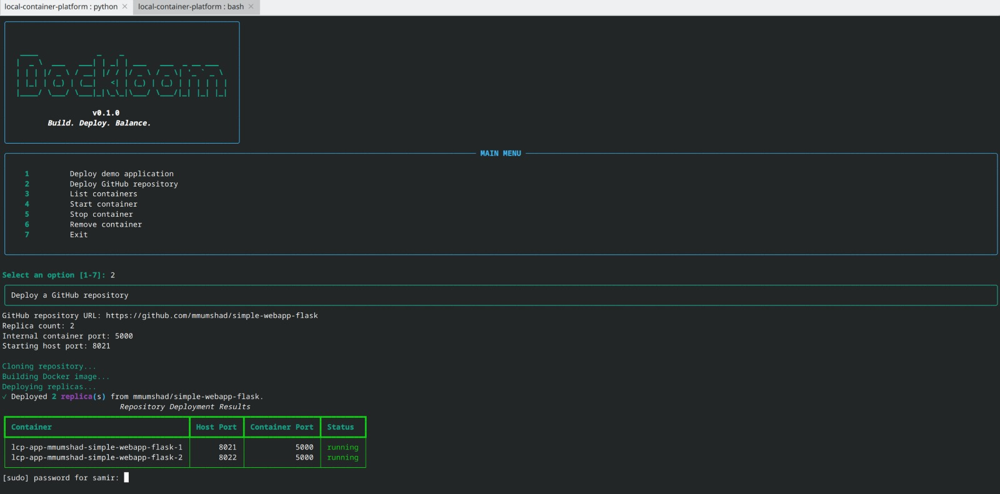

# Dockloom

**Build. Deploy. Balance.**

Dockloom is a lightweight, CLI-based platform for deploying and managing multiple instances of containerized applications on a single Linux host.

It combines Docker container management, GitHub repository deployment, basic container health checks, and Nginx load balancing behind an interactive command-line interface.

> **Project scope:** Dockloom is designed as a lightweight learning and development platform that demonstrates core container orchestration concepts. It is not intended to replace production orchestration platforms such as Kubernetes.



## Table of Contents

- [Problem Statement](#problem-statement)
- [Features](#features)
- [Technology Stack](#technology-stack)
- [Architecture](#architecture)
- [Requirements](#requirements)
- [Installation](#installation)
- [Usage](#usage)
- [GitHub Repository Deployment](#github-repository-deployment)
- [Load Balancing](#load-balancing)
- [Health Checks](#health-checks)
- [Testing](#testing)
- [Limitations](#limitations)
- [Future Improvements](#future-improvements)

## Problem Statement

Running multiple instances of an application locally can involve manually building Docker images, creating containers, assigning ports, tracking container states, and configuring a reverse proxy.

Dockloom brings these operations together through a Python-based controller and an interactive command-line interface.

The project demonstrates core container orchestration concepts on a single machine, including:

- Multi-container deployment
- Container lifecycle management
- Replica management
- Deployment from GitHub repositories
- HTTP load balancing
- Basic container health checks

## Features

- **Multi-replica deployment:** Deploy multiple instances of an application.
- **GitHub repository deployment:** Clone a GitHub repository, build its Docker image, and deploy replicas.
- **Container lifecycle management:** List, start, stop, and remove managed containers.
- **Port assignment:** Assign different host ports to application replicas.
- **Load balancing:** Distribute HTTP requests across running replicas using Nginx.
- **Dynamic Nginx synchronization:** Update the load balancer when managed containers are deployed, started, stopped, or removed.
- **Container health checks:** Check whether running containers are reachable through their published host ports.
- **Single application endpoint:** Access multiple replicas through a shared Nginx endpoint.
- **Container identification:** The built-in demonstration application identifies which replica handled a request.
- **Interactive CLI:** Manage deployments using a numbered menu.
- **Terminal styling:** Display formatted tables, panels, and status messages using Rich.
- **Automated testing:** Validate controller, CLI, and repository deployment behavior using pytest.

## Technology Stack

| Technology | Purpose |
|---|---|
| Python | Controller and CLI implementation |
| Docker Engine | Container runtime |
| Docker SDK for Python | Programmatic container management |
| FastAPI | Built-in demonstration application |
| Nginx | Reverse proxy and load balancer |
| Git | Repository cloning |
| Rich | CLI formatting and terminal styling |
| Pytest | Automated testing |
| GitHub | Source repository hosting |

## Architecture

```text
                         User
                          |
                          v
                    Dockloom CLI
                          |
              +-----------+-----------+
              |                       |
              v                       v
      Repository Deployer      Docker Controller
              |                       |
              v                       v
       Clone GitHub Repo         Docker Engine
              |                       |
              v                       v
        Build Docker Image    +------+------+ 
                              |      |      |
                              v      v      v
                           Replica Replica Replica
                              1       2       3
                              |       |       |
                              +-------+-------+
                                      |
                                      v
                              Nginx Load Balancer
                                      |
                                      v
                            http://localhost:8080


Dockloom uses a Python controller to communicate with Docker Engine.

When deploying the built-in application or a GitHub repository containing a Dockerfile, Dockloom creates one or more container replicas. Each replica is assigned its own host port.

Nginx acts as a reverse proxy and distributes HTTP traffic between the currently running replicas.

## Requirements

Before running Dockloom, ensure your Linux environment has:

- Python 3.12 or a compatible Python version
- Docker Engine installed and running
- Permission to communicate with Docker Engine
- Nginx installed and configured
- Git installed

You can verify Docker access using:

```bash
docker info
```

If Docker access fails, ensure Docker Engine is running and your user has the necessary permissions.

## Installation

### 1. Clone the Repository

```bash
git clone https://github.com/SamirChowdhary24/local-container-platform.git
cd local-container-platform
```

### 2. Create and Activate a Virtual Environment

```bash
python -m venv .venv
source .venv/bin/activate
```

### 3. Install Dependencies

```bash
pip install -r requirements.txt
```

### 4. Build the Demonstration Image

Dockloom includes a built-in FastAPI demonstration application.

Build its Docker image using:

```bash
docker build -t local-container-app:1.0 .
```

### 5. Configure Nginx

Dockloom uses Nginx as a reverse proxy and load balancer.

The controller synchronizes the Nginx upstream configuration based on the currently running replicas. Your Nginx server configuration should expose the shared application endpoint through port `8080`.

Before modifying an existing Nginx installation, review your current configuration to avoid affecting unrelated applications.

## Usage

Run Dockloom from the repository root:

```bash
dockloom
```

The CLI provides options for deploying applications and managing containers.

Available operations include:

- Deploy the built-in demo application
- Deploy a GitHub repository
- List managed containers
- Start a container
- Stop a container
- Remove a container
- Check container health

## Deploying the Demo Application

Choose the demo application deployment option and provide:

- Replica count
- Starting host port

For example, deploying three replicas starting at port `8011` creates:

| Replica | Host Port |
|---|---:|
| `lcp-app-1` | 8011 |
| `lcp-app-2` | 8012 |
| `lcp-app-3` | 8013 |

The individual replicas can be accessed directly through their assigned host ports.

For example:

```bash
curl http://localhost:8011
```

The built-in application returns information about the container handling the request, making it easier to identify individual replicas.

## GitHub Repository Deployment

Dockloom can deploy containerized applications directly from a GitHub repository.

The repository deployment workflow performs the following steps:

1. Accept a GitHub repository URL.
2. Clone the repository into a local workspace.
3. Build a Docker image using the repository's Dockerfile.
4. Create the requested number of container replicas.
5. Assign host ports to the replicas.
6. Synchronize the running replicas with Nginx.

When deploying a repository, Dockloom requests:

- GitHub repository URL
- Number of replicas
- Internal container port
- Starting host port

### Dockerfile Requirement

The repository must contain a `Dockerfile` in its root directory.

Dockloom displays this requirement before the deployment process begins.

This allows the platform to build the application using the repository's existing container configuration.

## Container Lifecycle Management

Dockloom supports basic lifecycle operations for managed containers.

### List Containers

The list containers feature displays:

- Container name
- Container ID
- Current status
- Published host port

This provides an overview of the containers currently managed by Dockloom.

### Start Container

A stopped container can be started by providing its container name.

After the container starts, Dockloom synchronizes the Nginx configuration so the running replica can receive traffic.

### Stop Container

A running container can be stopped using its container name.

After stopping the container, Dockloom synchronizes the load balancer configuration so traffic is directed only to the remaining running replicas.

### Remove Container

A stopped container can be removed using its container name.

After removal, Dockloom synchronizes the Nginx configuration with the remaining running replicas.

Docker does not allow a running container to be removed normally. It must first be stopped or force removed.

## Load Balancing

Dockloom uses Nginx as a reverse proxy and load balancer.

Instead of requiring users to access each container separately, Dockloom provides a shared endpoint:

```text
http://localhost:8080
```

Nginx forwards incoming HTTP requests to the currently running application replicas.

```text
Client Request
      |
      v
localhost:8080
      |
      v
Nginx Load Balancer
   /      |      \
  v       v       v
8011     8012     8013
```

The controller synchronizes the Nginx upstream configuration when managed containers are deployed, started, stopped, or removed.

This means that stopped containers can be removed from the active load-balancing configuration while running containers remain available to receive traffic.

### Demonstrating Load Balancing

The built-in FastAPI application includes container identity information in its response.

You can send requests to the shared Nginx endpoint:

```bash
curl http://localhost:8080
```

The response identifies the container that handled the request, making it possible to demonstrate traffic distribution between replicas.

Individual replicas can also be accessed directly through their assigned host ports.

## Health Checks

Dockloom includes a basic health check for running managed containers.

The health check verifies whether a container is reachable through its published host port.

The result is displayed as either:

- **HEALTHY** — The container is reachable.
- **UNHEALTHY** — The container could not be reached.

This provides additional information beyond the Docker container status.

A container may be reported as running by Docker while its application is unavailable or not accepting connections correctly. The health check provides a simple network-level availability check for this situation.

## Testing

Dockloom includes automated tests for its core functionality.

The tests cover areas including:

- Docker controller behavior
- Container deployment logic
- CLI behavior
- Repository deployment behavior

Run the test suite from the repository root:

```bash
pytest -q
```

You can also check Python syntax before committing:

```bash
python -m py_compile controller/docker_controller.py controller/cli.py
```

Check for whitespace errors using:

```bash
git diff --check
```

## Limitations

Dockloom currently has several limitations:

- It is designed for a single Linux host.
- It depends on Docker Engine and Nginx being installed and configured.
- GitHub repository deployment currently requires a Dockerfile in the repository root.
- The health check is a basic network reachability check rather than deep application monitoring.
- Automatic recovery of failed containers is not currently implemented.
- The platform does not provide multi-node orchestration or scheduling.
- Production security features such as authentication, secrets management, and automated TLS configuration are outside the current scope.

## Future Improvements

Possible future improvements include:

- [ ] Automatic recovery of unhealthy containers
- [ ] Application-level health checks using configurable endpoints
- [ ] Configurable load-balancing strategies
- [ ] Container resource monitoring
- [ ] Basic rollback support
- [ ] Support for Dockerfiles located outside the repository root
- [ ] Support for deploying applications across multiple hosts
- [ ] Improved security and network isolation

## Project Status

The core functionality of Dockloom is implemented.

The current version demonstrates the following workflow:

```text
Build Application
       |
       v
Deploy Containers
       |
       v
Manage Replicas
       |
       v
Check Container Availability
       |
       v
Synchronize Load Balancer
       |
       v
Route Traffic Through a Shared Endpoint
```

Dockloom is a lightweight project that demonstrates how Docker container management, replica deployment, basic health checking, GitHub-based deployment, and HTTP load balancing can be combined into a single tool.

## Project Goal

The goal of Dockloom is to make core container deployment concepts easier to understand and operate on a single machine.

Rather than manually coordinating Docker commands, ports, GitHub repositories, and Nginx configuration, Dockloom provides a unified workflow through an interactive CLI.

The project demonstrates several concepts commonly found in larger container orchestration platforms while keeping the implementation small enough to understand, test, and demonstrate.
